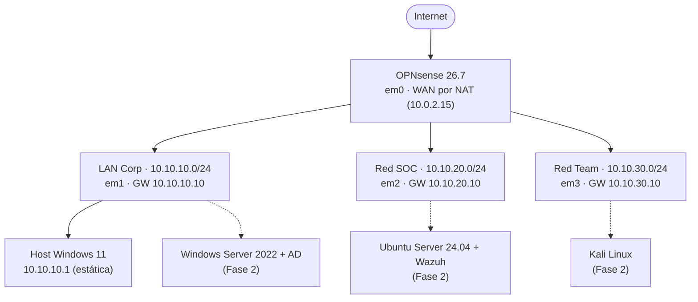

# Fase 1 — Red y Firewall

**Estado:** ✅ Completada (2026-10-12)
**Firewall:** OPNsense 26.7 "Xenial Xenops"
**Hipervisor:** VirtualBox (host Windows 11)

## 1. Objetivo

Montar la base de red del laboratorio: segmentación en 3 zonas (corporativa, SOC y Red Team), ruteo entre segmentos, DHCP, DNS local y política de firewall con aislamiento de la red de ataque. Todo verificable con pruebas y logs.

## 2. Topología



Las 3 redes son **solo-anfitrión (host-only)** de VirtualBox, sin DHCP del hipervisor. El host ocupa la `.1` de cada segmento y OPNsense la `.10` (gateway). No hay interfaz de management dedicada: la administración web es por LAN (`https://10.10.10.10`).

> Nota: existe una cuarta red host-only `192.168.56.0/24` creada por VirtualBox que **no se usa** en el lab.

## 3. Direccionamiento

| Red | Subnet | Host | Gateway (OPNsense) | DHCP |
|---|---|---|---|---|
| LAN Corp | `10.10.10.0/24` | `10.10.10.1` | `10.10.10.10` | No (IPs estáticas) |
| Red SOC | `10.10.20.0/24` | `10.10.20.1` | `10.10.20.10` | Kea, pool `.100`–`.200` |
| Red Team | `10.10.30.0/24` | `10.10.30.1` | `10.10.30.10` | Kea, pool `.100`–`.200` |

## 4. Configuración de OPNsense 26.7

### 4.1 Interfaces

| Interfaz física | Nombre | Rol | IP |
|---|---|---|---|
| em0 | WAN | Salida a internet (NAT de VirtualBox) | DHCP (`10.0.2.15`) |
| em1 | LAN | Red corporativa | `10.10.10.10/24` estática |
| em2 | SOC | Red de monitoreo | `10.10.20.10/24` estática |
| em3 | REDTEAM | Red de ataque | `10.10.30.10/24` estática |

Ajuste en **Interfaces → WAN**: desmarcado `Block private networks` (la WAN recibe una IP privada del NAT de VirtualBox).

### 4.2 DHCP — Kea

En 26.7 el servidor DHCP es **Kea** (`Services → Kea DHCP`); el menú ISC DHCPv4 ya no existe.

| Subnet | Pool | Auto collect option data |
|---|---|---|
| `10.10.20.0/24` (SOC) | `10.10.20.100` – `10.10.20.200` | ✅ (gateway y DNS automáticos) |
| `10.10.30.0/24` (REDTEAM) | `10.10.30.100` – `10.10.30.200` | ✅ |

### 4.3 DNS — Unbound

`Services → Unbound DNS → General`:

- **Enable**: ✅
- **Network Interfaces**: LAN, SOC, REDTEAM, localhost
- **Register DHCP Static Mappings**: ✅ (las reservas Kea con hostname resuelven por DNS)
- Dominio del lab (`System → Settings → General → Domain`): `lab.local`
- **Access Lists**: `10.10.10.0/24`, `10.10.20.0/24`, `10.10.30.0/24` en Allow

> "Register ISC DHCP4 Leases" **no** se usa: es del backend ISC (eliminado en 26.7) y su comportamiento con Kea es incierto. Para hosts de infraestructura se usan reservas Kea con hostname o Host Overrides.

### 4.4 Reglas de firewall

Evaluación de arriba hacia abajo, primera coincidencia gana. Todo lo no permitido cae en default deny.

**LAN** (permite todo, como en un entorno corporativo estándar):

| Orden | Acción | Origen | Destino | Descripción |
|---|---|---|---|---|
| 1 | Pass | LAN net | any | Default allow LAN to any rule |

**REDTEAM** (aislada de las otras zonas, con salida a internet para updates/herramientas):

| Orden | Acción | Origen | Destino | Log | Descripción |
|---|---|---|---|---|---|
| 1 | Block | REDTEAM net | LAN net | ✅ | Aislar RedTeam de LAN Corp |
| 2 | Block | REDTEAM net | SOC net | ✅ | Aislar RedTeam de SOC |
| 3 | Pass | REDTEAM net | any | — | RedTeam a Internet |

**SOC** (el sensor debe resolver DNS; el resto se endurece en Fase 2):

| Orden | Acción | Proto | Origen | Destino | Puerto | Log | Descripción |
|---|---|---|---|---|---|---|---|
| 1 | Pass | TCP/UDP | SOC net | `10.10.20.10` | 53 (DNS) | ✅ | DNS TCP/UDP a firewall desde SOC |

## 5. Pruebas realizadas

### 5.1 Ruteo entre segmentos ✅

Con el host en los 3 segmentos a la vez, el tráfico iría directo sin pasar por el firewall. Para probar el ruteo real:

1. Deshabilitar en Windows los adaptadores host-only de SOC y Red Team.
2. Agregar rutas estáticas:
   ```powershell
   route add 10.10.20.0 mask 255.255.255.0 10.10.10.10
   route add 10.10.30.0 mask 255.255.255.0 10.10.10.10
   ```
3. `tracert 10.10.20.10` → 2 saltos: `10.10.10.10` → `10.10.20.10` (tráfico pasando por el firewall).
4. `ping 10.10.20.10` → responde.

### 5.2 Bloqueo LAN → SOC con evidencia en logs ✅

1. Regla temporal en LAN: Block, LAN net → SOC net, con Log (`PRUEBA temporal`), ubicada arriba del default-allow.
2. `pfctl -k 10.10.20.10` en consola (mata estados existentes: el firewall stateful no re-evalúa conexiones ya establecidas).
3. `ping 10.10.20.10` → **falla**.
4. `Firewall → Log Files → Live View` → bloqueo visible en vivo, con la regla `PRUEBA temporal` como causa.
5. Limpieza: regla eliminada, default-allow restaurado, rutas borradas, adaptadores rehabilitados.

### 5.3 DNS ✅

`Diagnostics → DNS Lookup` → `google.com` resuelve correctamente (Unbound operativo). La validación desde clientes de cada segmento queda para la Fase 2, cuando existan VMs.

## 6. Particularidades de OPNsense 26.7 detectadas

- **DHCP = Kea.** El menú `Services → DHCPv4` (ISC) no existe más.
- **Firewall → Rules es la UI nueva (MVC).** La legacy pasó a plugin. Para reordenar: tildar el checkbox de la regla y clic en la flecha `←` de la regla destino (se inserta *antes* de ella). El drag & drop no funciona.
- **States:** después de cambiar reglas, matar estados con `pfctl -k <ip>` o los cambios no aplican a conexiones existentes.
- **Diagnóstico de camino:** `tracert` revela si el tráfico realmente pasa por el firewall (1 salto = directo, 2 saltos = vía gateway).

## 7. Próximos pasos (Fase 2)

- [ ] Windows Server 2025 + Active Directory (LAN Corp)
- [ ] Ubuntu Server 26.04 + Wazuh (Red SOC)
- [ ] Windows 10 Enterprise como víctima (LAN Corp)
- [ ] Kali Linux como atacante (Red Team)
- [ ] Reservas Kea con hostname para cada servidor
- [ ] Validar DNS desde clientes en cada segmento (`nslookup`)
